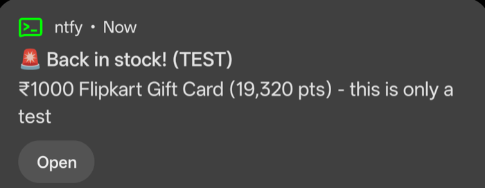
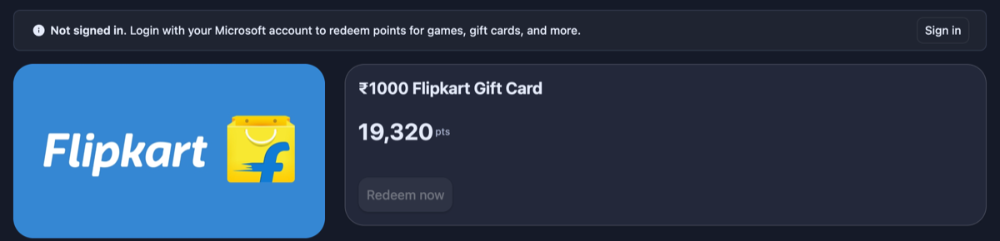
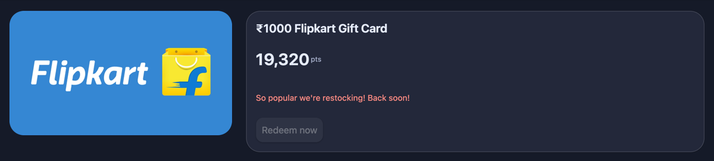
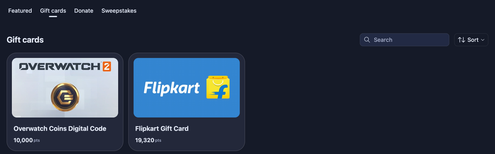

# Rewards_Watcher

**v2.1.1** · [Changelog](CHANGELOG.md) · 📱 [Android app (alpha)](android/README.md)

Get a phone alert the moment a Microsoft Rewards gift card comes back in stock.

In India (and some other regions), Microsoft Rewards gift cards like Amazon
and Flipkart are almost always "out of stock", and when they do restock they
sell out within minutes. Rewards_Watcher checks the Rewards store every few
minutes and alerts you on your **phone** (free, via [ntfy](https://ntfy.sh)),
by **email**, on your **Mac**, or on **WhatsApp**, so you can redeem before it's gone.

<p align="center">
  
</p>

- **Read-only.** It never clicks Redeem and never touches your points.
- **Polite.** One page load every 4 minutes by default (2 minutes minimum).
- **Tap to redeem.** Alerts open the gift card's page directly.
- **Future-proof.** Reads the whole gift card list on every check, so new
  cards Microsoft adds later are picked up automatically.
- **Restock history.** Logs every restock and how long it lasted, so you can
  see how often Microsoft really restocks.

---

## How it works

The Rewards store only tells you whether a card is in stock **when you're
signed in**. Signed out, every card shows the same greyed-out button:

| Signed out: can't tell | Signed in: real stock status |
|---|---|
|  |  |

So Rewards_Watcher uses a browser profile that you sign in to once, then
every few minutes it loads the gift card list:



and compares it with the previous check:

| What changed | What you get |
|---|---|
| A card went from "restocking" to redeemable | 🚨 **Back in stock!** (max priority alert) |
| A card appeared that wasn't listed before (new card, or one that was hidden while sold out) | 🔔 New on the store |
| A card sold out or disappeared | Logged quietly |
| Your sign-in expired | 🔔 Asks you to log in again |

---

## Quick start

Needs **Python 3.9+** and macOS or Linux. Uses Microsoft Edge or Google
Chrome if installed (only for signing in), otherwise downloads a Chromium
browser automatically.

```bash
git clone https://github.com/Mohammed-Shajith/Rewards_Watcher.git
cd Rewards_Watcher
./setup.sh
```

`setup.sh` installs everything into a local `.venv` folder and runs a short
setup wizard (region, phone and email alerts). Then:

```bash
.venv/bin/python rewards_watcher.py login        # sign in once (a browser window opens)
.venv/bin/python rewards_watcher.py test-alert   # check alerts reach you
.venv/bin/python rewards_watcher.py run          # start watching
```

On `login`, sign in to Microsoft Rewards in the window that opens, then come
back to the terminal and press Enter. The sign-in is saved in `profile/`,
a separate browser profile, not your everyday one. **Keep that folder
private.**

<details>
<summary>Manual install (without setup.sh)</summary>

```bash
python3 -m venv .venv
.venv/bin/pip install -r requirements.txt
# only if you have neither Edge nor Chrome:
.venv/bin/python -m playwright install chromium
.venv/bin/python rewards_watcher.py setup
```
</details>

---

## Alerts

### 📱 Phone (ntfy, free, recommended)

[ntfy](https://ntfy.sh) is a free, open-source push notification app. No
account needed.

1. Install the ntfy app:
   [Android](https://play.google.com/store/apps/details?id=io.heckel.ntfy) ·
   [iPhone](https://apps.apple.com/app/ntfy/id1625396347)
2. Run `.venv/bin/python rewards_watcher.py setup` and answer **y** to phone
   alerts. It generates a private topic like `rewards-3f9c…`.
3. In the app tap **+**, paste the topic, keep the server as `ntfy.sh`, and
   tap **Subscribe**. On Android you can also open `ntfy://ntfy.sh/<topic>`
   on the phone.
4. Run `test-alert`.

Restock alerts are sent at **max priority** and every other alert at high
priority, so both pop up as banners.

> **Android battery savers** (Realme, Xiaomi, Oppo, Vivo, Samsung) can delay
> notifications. Set ntfy's battery usage to *Unrestricted* / allow
> background activity.

> Anyone who knows your topic name can read your alerts. The generated name
> is long and random, so don't post it publicly.

### 📧 Email (no app needed)

Works with any email provider. With Gmail:

1. Turn on [2-Step Verification](https://myaccount.google.com/signinoptions/twosv)
   on the Google account you'll send from.
2. Create an [App Password](https://myaccount.google.com/apppasswords)
   (a 16-character code just for this tool, not your normal password).
3. Run `.venv/bin/python rewards_watcher.py setup`, answer **y** to email,
   and enter the Gmail address, who to send alerts to (one or more
   addresses), and the App Password.

Restock emails are marked high priority and include an **Open on Microsoft
Rewards** button. For other providers, change `smtp_host`, `smtp_port` and
`security` (`ssl` for port 465, `starttls` for port 587) in `config.json`.

> The App Password is stored in `config.json`, which is git-ignored and
> readable only by you. You can use the `RW_EMAIL_PASSWORD` environment
> variable instead.

### 💻 Mac notifications

On by default on macOS. For banners that open the card's page when clicked:

```bash
brew install terminal-notifier
```

Then allow it in **System Settings → Notifications → terminal-notifier**.
Without it, the watcher falls back to AppleScript notifications, which show
up under *Script Editor* and can't open links.

### 💬 WhatsApp (CallMeBot, free)

1. Follow [CallMeBot's setup](https://www.callmebot.com/blog/free-api-whatsapp-messages/)
   to get an API key (send their bot a WhatsApp message). Their free bot is
   sometimes full; try again in a few days if so.
2. In `config.json`:

```json
"whatsapp": { "enabled": true, "phone": "+91XXXXXXXXXX", "apikey": "123456" }
```

---

## Commands

| Command | What it does |
|---|---|
| `setup` | First-time wizard: region, phone and email alerts, writes `config.json` |
| `login` | Opens a browser so you can sign in once (also writes `session.json`) |
| `export-session` | Re-writes `session.json` from your browser profile, for server mode |
| `check` | Checks the store once and prints every card |
| `run` | Keeps checking and sends alerts (Ctrl+C to stop) |
| `history` | Restock log, with how long each restock lasted |
| `test-alert` | Sends a test to every enabled alert channel |

Example `check` output:

```
Signed in: yes   items: 2
   000485000005   10,000 pts  out of stock      Overwatch Digital Code—1000 Coins
 * 000885000034   19,320 pts  out of stock      ₹1000 Flipkart Gift Card
 (* = you'll get alerts for this item)
```

### Keeping it running

**On a Mac, run it in the background** (recommended). It starts at login,
restarts if it crashes, keeps running after you close the terminal, and
stops the Mac from idle-sleeping:

```bash
./deploy/macos-agent.sh install     # set up and start
./deploy/macos-agent.sh status      # running? last checks
./deploy/macos-agent.sh logs        # live log (data/watcher.log)
./deploy/macos-agent.sh restart     # after editing config.json
./deploy/macos-agent.sh stop        # pause until next login
./deploy/macos-agent.sh uninstall   # remove completely
```

Or just in a terminal: `caffeinate -i .venv/bin/python rewards_watcher.py run`.

The watcher runs in lite mode (no browser) using the `session.json` that
`login` writes, so it never touches your everyday Edge or Chrome.

**When does it watch?** Only while the Mac is awake:

| Mac state | Watching? |
|---|---|
| Open, even with the screen off or locked | ✅ |
| Lid closed (asleep) | ❌ macOS always sleeps a closed MacBook, unless it's plugged in with an external display |
| Just woke up | ✅ resumes within a few minutes |
| After a restart | ✅ with the background agent, once you log in |

To catch 3 AM restocks while your laptop sleeps, use server mode.

---

## Server mode (run 24/7)

Run the watcher on an always-on Linux machine. You still **sign in on your
own computer**: the server never needs a screen or your password. You copy
your sign-in to it as a `session.json` file.

```
 Your computer                             Server (Pi / laptop / cloud VM)
 ─────────────                             ───────────────────────────────
 login  ──► session.json ──(scp / ssh)──►  session.json ──► run (systemd)
                                            keeps it refreshed, alerts you
```

### Which server?

| Option | Cost | Notes |
|---|---|---|
| **Raspberry Pi 4/5 or an old laptop at home** ⭐ | Pi ~₹5–7k once, old laptop free | Uses your home internet, the same kind of connection you normally use Rewards from, so the fewest surprises. Needs a **64-bit** OS (Raspberry Pi OS 64-bit, Ubuntu). |
| **Oracle Cloud Always Free** (Ampere A1 Arm VM) | Free (card needed to sign up) | Pick an Indian region (Mumbai/Hyderabad) for the Indian store. Free Arm capacity is often "out of capacity", and Oracle can reclaim *idle* free VMs. Datacenter IPs may make Microsoft re-ask for sign-in more often. |
| **Any small VPS** | ~₹350–500/month | Same as Oracle but no capacity lottery. 1 GB RAM is enough. |

With the **lite install** (below) the server needs no browser at all, just Python, so
even the smallest machines work (Oracle's 1 GB AMD Micro, a Pi Zero 2, an old
32-bit laptop).

### Setup

**1. On the server** (Ubuntu / Debian / Raspberry Pi OS 64-bit):

```bash
sudo apt update && sudo apt install -y git python3 python3-venv
git clone https://github.com/Mohammed-Shajith/Rewards_Watcher.git
cd Rewards_Watcher
./setup.sh --lite     # Python only: no Playwright, no Chromium (recommended)
```

Lite mode checks the store with plain web requests using your `session.json`.
Use `./setup.sh` (full) instead if you want the headless-browser fetcher.

In the wizard, set up ntfy and/or email: Mac notifications are skipped on
Linux. To reuse your existing ntfy topic and email settings, copy your
`config.json` over instead (`scp config.json user@server:Rewards_Watcher/`).

**2. On your computer**, after `login` has been done once (stop the local
watcher first if it's running):

```bash
./deploy/push-session.sh user@server
```

This exports `session.json` from your browser profile and copies it to the
server over SSH.

**3. On the server**, install the auto-start service:

```bash
./deploy/install-service.sh
```

It runs one `check` to confirm the sign-in works, then installs a systemd
service that starts on boot and restarts if it crashes.

```bash
sudo systemctl status rewards-watcher      # is it running?
journalctl -u rewards-watcher -f           # live log
sudo systemctl restart rewards-watcher     # after editing config.json
```

### When the session expires

You'll get a "signed out" alert. On your computer run `login` again, then
`./deploy/push-session.sh user@server`. The server picks up the new file on
its next check, with no restart needed.

> **`session.json` is as sensitive as your password**: whoever has it is
> signed in to your Microsoft account. It's created owner-only
> (`chmod 600`), git-ignored, and should only ever travel over SSH to a
> machine you control.

Don't run the watcher on your computer and the server at the same time, or
you'll get every alert twice.

---

## Configuration (`config.json`)

Created by `setup` (see [`config.example.json`](config.example.json)).

| Key | Default | Meaning |
|---|---|---|
| `country` | `"in"` | Store region, as in `rewards.bing.com/redeem/in/shop` |
| `browser` | `"auto"` | `auto`, `msedge`, `chrome` or `chromium` |
| `fetcher` | `"auto"` | `browser` (headless browser), `lite` (plain HTTP, no browser), or `auto` (lite with `session.json`, browser only with a profile and no `session.json`) |
| `auth` | `"auto"` | `profile` (browser profile on this machine), `session` (`session.json`), or `auto`: `session.json` whenever it exists, so the watcher runs without a hidden browser |
| `interval_minutes` | `4` | Time between checks (minimum 2) |
| `watch` | `[]` | Only alert for these: item ID or part of the title, e.g. `["amazon", "flipkart"]`. Empty = every card |
| `ignore` | `["overwatch"]` | Never alert for these |
| `extra_skus` | `[]` | Extra item IDs to check from their own page |
| `mac_notifications` | `true` | macOS notifications |
| `ntfy` | off | `enabled`, `server`, `topic` |
| `email` | off | `enabled`, `smtp_host`, `smtp_port`, `security`, `username`, `password`, `from`, `to` (list) |
| `whatsapp` | off | `enabled`, `phone`, `apikey` (CallMeBot) |

---

## Troubleshooting

| Problem | Fix |
|---|---|
| "signed out" alert, or `check` says `Signed in: NO` | Your session expired. Run `login` again. |
| "having trouble" alert after 5 failed checks | Run `check` to see the error. The site may have changed. |
| Phone alert only shows inside the ntfy app | Close the app (it doesn't notify for the topic you're viewing) and check battery settings. |
| Mac banner opens Script Editor | Install and allow `terminal-notifier` (see above). |
| `login` window doesn't open | Set `"browser"` in `config.json` to one you have installed. |
| macOS: clicking Edge/Chrome in the Dock shows no window | An older version kept a hidden browser running. Update to 2.1.1+ and run `./deploy/macos-agent.sh restart`. |
| `export-session` says the profile is in use | Stop the watcher on that computer (Ctrl+C, or `./deploy/macos-agent.sh stop`), then retry. `push-session.sh` does this for you. |
| Server: `check` says `Signed in: NO` | Copy a fresh session: `./deploy/push-session.sh user@server`. |

---

## For developers

Everything is in one file, [`rewards_watcher.py`](rewards_watcher.py), using
only the Python standard library plus [Playwright](https://playwright.dev/python/).

**Where the stock data comes from.** `rewards.bing.com` is a Next.js app.
The gift card list is embedded in the page as React Server Component data
inside `<script>self.__next_f.push([1,"..."])</script>` tags. Each card looks
like:

```json
{
  "id": "000885000034",
  "fullTitle": "₹1000 Flipkart Gift Card",
  "price": 19320,
  "isDisabled": true,
  "isEligible": true,
  "href": "/redeem/sku/000885000034"
}
```

The site's own code shows "So popular we're restocking!" when
`isDisabled && isSignedIn && isEligible`. So `isDisabled` means **out of stock
only for signed-in users**. Signed out, it's always `true`. The page also
carries `"isSignedIn": true|false`, which the watcher uses to detect an
expired session.

**Flow.**

1. `fetch()`: requests `/redeem/{country}/shop` with your sign-in cookies.
   Two fetchers share the same interface:
   - `Store`: headless browser (Playwright) with the local profile or `session.json`.
   - `LiteStore`: plain `urllib` with the cookies from `session.json`. It
     merges refreshed cookies back into the file. Standard library only.
   `make_store()` picks one from the `fetcher` setting.
2. `parse_store()`: joins and unescapes the `__next_f` chunks, then
   JSON-decodes every `"items":[...]` array.
3. `record()`: compares with the last state in SQLite (`data/rewards.db`,
   tables `items` and `events`) and returns events: `restocked`, `sold_out`,
   `listed`, `delisted`.
4. `alert()`: sends to Mac / ntfy / email / WhatsApp. One failing channel never stops
   the others or the watcher.

If Microsoft changes the page, `parse_store()` is the place to fix.

### Contributing

Issues and pull requests are welcome. Fork the repo, work on a branch, and
open a pull request against `main`. `main` is protected, and changes land
only when the maintainer merges a PR. See [CONTRIBUTING.md](CONTRIBUTING.md).

Never commit `config.json`, `session.json`, `profile/` or `data/`. They hold
your sign-in, alert topic and email password, and `.gitignore` already
excludes them.

---

## Roadmap

- [x] **Server mode**: run 24/7 on a Raspberry Pi, old laptop or cloud VM
- [x] **macOS background agent**: start at login, survive closing the terminal
- [x] **Lite mode** (v2.1): no browser needed, standard library only
- [ ] **Android app**: alpha in [`android/`](android/README.md). Native, ~53 KB, checks every 10 min with exact alarms
- [ ] More stores/regions tested
- [ ] Optional daily summary

---

## Disclaimer

This is an independent personal project. It is **not affiliated with,
endorsed by, or sponsored by Microsoft**. Microsoft, Bing, Microsoft Rewards
and the gift card brands shown are trademarks of their respective owners.
Screenshots are included only to explain how the tool works.

Microsoft's Rewards terms restrict automated activity. Rewards_Watcher only
reads the public store page at a low rate with your own signed-in session,
and never earns or redeems points, but **use it at your own risk**.

## License

[MIT](LICENSE)
